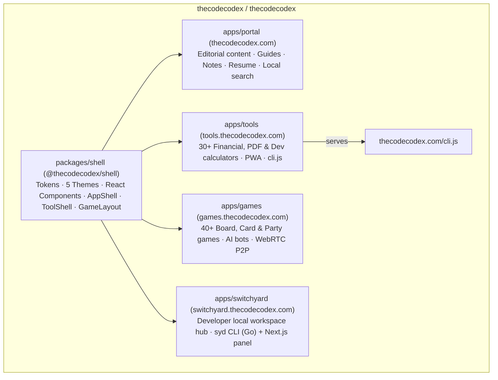

<div align="center">

# The Code Codex

**Study notes, hands-on guides, board games and zero-install client-side tools for developers — in Portuguese and English.**

[thecodecodex.com](https://thecodecodex.com) · [Tools](https://tools.thecodecodex.com) · [Games](https://games.thecodecodex.com) · [Switchyard](https://switchyard.thecodecodex.com) · [Design System](https://designsystem.thecodecodex.com) · [`cli.js`](https://thecodecodex.com/cli.js)

[](https://github.com/thecodecodex/thecodecodex)
[](https://opensource.org/licenses/MIT)

</div>

---

## 🏛️ Ecosystem Architecture

All projects are organized within a unified monorepo ([**thecodecodex/thecodecodex**](https://github.com/thecodecodex/thecodecodex)) powered by **pnpm workspaces**:



---

## 📦 What we build

| Project | What it is | Stack | Status |
| :--- | :--- | :--- | :--- |
| [**Portal**](https://thecodecodex.com) | The main hub: engineering guides, quick study notes, project showcases and offline-ready search powered by Pagefind | Astro 5 · Preact · Tailwind CSS v4 · Pagefind | 🌐 [thecodecodex.com](https://thecodecodex.com) |
| [**Tools**](https://tools.thecodecodex.com) | 30+ client-side developer, Brazilian tax/finance calculators (CLT x PJ, Simples Nacional, 13º, IRRF 2026), PDF Studio, converters and PWA | Astro 5 · Preact · Tailwind CSS v4 · Vitest | 🌐 [tools.thecodecodex.com](https://tools.thecodecodex.com) |
| [**Games**](https://games.thecodecodex.com) | 40+ classic board, card, and party games (Chess, Mancala, Poker, Truco, Domino, Buraco...) with bot simulations and peer-to-peer multiplayer | Astro 5 · Preact · WebRTC · Durable Objects | 🌐 [games.thecodecodex.com](https://games.thecodecodex.com) |
| [**Switchyard**](https://switchyard.thecodecodex.com) | Local developer environment hub for engineers managing multiple repositories: Git dashboard, Azure Boards, mocks, cloud logs, and the `syd` CLI | Go 1.26 · Next.js 16 (Turbopack) · Tailwind CSS v4 | 🌐 [switchyard.thecodecodex.com](https://switchyard.thecodecodex.com) |
| [**Shell**](https://designsystem.thecodecodex.com) | Shared design system: design tokens, 5 themes, form controls, match views and application shells (`AppShell`, `ToolShell`, `GameLayout`) | React / Preact · Tailwind CSS v4 · Storybook | 📚 [designsystem.thecodecodex.com](https://designsystem.thecodecodex.com) |

---

## 💡 Core Principles

- **100% On-Device & Private:** In Tools and Games, all computation runs strictly inside your browser. No files, payroll figures or inputs ever leave your machine.
- **One Logic, Multiple Surfaces:** The calculation models running in the browser are identical to those executing via the terminal script (`cli.js`) and validated in automated test suites.
- **Accessible & Multi-Theme by Default:** Five built-in themes (*Claro*, *Papel*, *Crepúsculo*, *Escuro*, and *Alto Contraste*) with verified WCAG contrast standards, visible keyboard navigation, and motion-reduction support.
- **Bilingual (PT / EN):** Every article, guide, tool, game, and terminal command provides first-class support in Portuguese and English.
- **Edge Deployment:** Hosted on Cloudflare Workers for instant sub-millisecond global delivery with zero cold starts.

---

## ⚡ Try Tools from the Terminal

Every calculator and utility on Codex Tools can be run directly from your terminal using Deno or Node without installing any package:

```sh
# Calculate Brazilian CLT net salary with 2026 tax tables:
deno run -q "https://thecodecodex.com/cli.js?tool=net-salary&bruto=8000"

# Generate 3 valid test CPFs:
curl -s https://thecodecodex.com/cli.js | node --input-type=module - cpf q=3

# List all available CLI tools:
deno run -q "https://thecodecodex.com/cli.js"
```

---

## 📬 Contact, Feedback & Bug Reports

We love feedback! You can reach out directly via:

- **Email:** [`contato.thecodecodex@gmail.com`](mailto:contato.thecodecodex@gmail.com)
- **Email Subject Tags:**
  - `[TheCodeCodex] [Bug] [Tools|Games|Portal|Switchyard] <Title>` — to report bugs.
  - `[TheCodeCodex] [Sugestão] [Tools|Games] <Name>` — to suggest new tools or games.
  - `[TheCodeCodex] [Contato] [Project]` — for general inquiries and feedback.
- **In-App Buttons:** Every tool features a contextual **"Reportar bug" / "Report a bug"** button that automatically pre-populates the current URL and page details.

---

## 💻 Repository & Contributions

The primary monorepo is located at [**github.com/thecodecodex/thecodecodex**](https://github.com/thecodecodex/thecodecodex).

```sh
git clone git@github.com:thecodecodex/thecodecodex.git
cd thecodecodex
pnpm install
pnpm verify   # runs typecheck, lint, and builds across all workspaces
```
