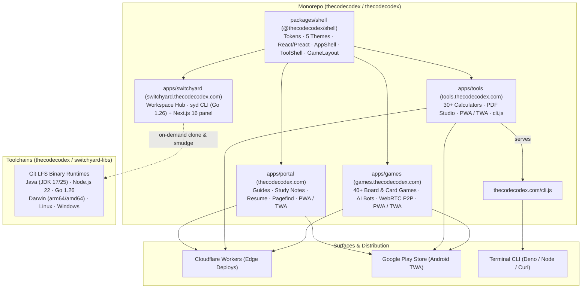

<div align="center">

# The Code Codex

**Study notes, hands-on engineering guides, board games, and zero-install client-side tools for developers — in Portuguese, English, and Spanish.**

Founded & Maintained by **[Douglas Capeletti](https://www.linkedin.com/in/douglas-capeletti/)** (Founder, Lead Architect & Owner)

[thecodecodex.com](https://thecodecodex.com) · [Tools](https://tools.thecodecodex.com) · [Games](https://games.thecodecodex.com) · [Switchyard](https://switchyard.thecodecodex.com) · [Design System](https://designsystem.thecodecodex.com) · [`cli.js`](https://thecodecodex.com/cli.js)

[](https://www.linkedin.com/in/douglas-capeletti/)
[](https://github.com/douglas-capeletti)
[](https://github.com/thecodecodex/thecodecodex)
[](https://github.com/thecodecodex/switchyard-libs)
[](https://opensource.org/licenses/MIT)

</div>

---

## 👨‍💻 Founder & Leadership

**The Code Codex** is an independent open-source engineering ecosystem created, architected, and owned by **[Douglas Capeletti](https://www.linkedin.com/in/douglas-capeletti/)**.

- 💼 **LinkedIn:** [linkedin.com/in/douglas-capeletti](https://www.linkedin.com/in/douglas-capeletti/)
- 🐙 **GitHub:** [@douglas-capeletti](https://github.com/douglas-capeletti)
- ✉️ **Contact:** [`contato.thecodecodex@gmail.com`](mailto:contato.thecodecodex@gmail.com)

Douglas leads the vision, technical architecture, and implementation across all projects in the organization — establishing the foundational principles of 100% on-device privacy, trilingual accessibility (PT / EN / ES), shared design systems, and modern edge-native developer tooling.

---

## 🏛️ Ecosystem Architecture

The organization manages two core open-source repositories:

1. [**thecodecodex/thecodecodex**](https://github.com/thecodecodex/thecodecodex) — The primary monorepo powered by **pnpm workspaces**, bundling all web applications, desktop/CLI hubs, shared design systems, and Android packaging pipelines.
2. [**thecodecodex/switchyard-libs**](https://github.com/thecodecodex/switchyard-libs) — Centralized multi-platform binary runtimes repository (JDK 17, JDK 25, Node.js 22, Go) tracked with **Git LFS** and SHA-256 checksums, consumed on demand by Switchyard.



---

## 📦 Repositories & Projects

### Repositories

| Repository | Purpose | Visibility | Stack |
| :--- | :--- | :--- | :--- |
| [**thecodecodex/thecodecodex**](https://github.com/thecodecodex/thecodecodex) | Primary Monorepo (Portal, Tools, Games, Switchyard, Shell) | Public | Astro 5 · Preact · Next.js 16 · Go 1.26 · Tailwind CSS v4 |
| [**thecodecodex/switchyard-libs**](https://github.com/thecodecodex/switchyard-libs) | Managed Toolchains & Runtimes for Switchyard (JDK, Node, Go) | Public | Git LFS · Shell · Multi-platform Binaries |
| [**thecodecodex/.github**](https://github.com/thecodecodex/.github) | Organization profile, community health and shared meta | Public | Markdown |

### Applications & Packages

| Project | Description | Stack | Distribution |
| :--- | :--- | :--- | :--- |
| [**Portal**](https://thecodecodex.com) | Editorial hub: engineering guides, quick study notes, project showcases, and offline-ready search powered by Pagefind | Astro 5 · Preact · Tailwind CSS v4 · Pagefind | 🌐 [thecodecodex.com](https://thecodecodex.com) · 📱 Android TWA |
| [**Tools**](https://tools.thecodecodex.com) | 30+ client-side developer & Brazilian tax/finance calculators (CLT x PJ, Simples Nacional, 13º, IRRF 2026), PDF Studio, converters and CLI | Astro 5 · Preact · Tailwind CSS v4 · Vitest | 🌐 [tools.thecodecodex.com](https://tools.thecodecodex.com) · 📱 Android TWA · 💻 CLI |
| [**Games**](https://games.thecodecodex.com) | 40+ classic board, card, and party games (Chess, Mancala, Poker, Truco, Domino, Buraco...) with bot simulations and peer-to-peer multiplayer | Astro 5 · Preact · WebRTC · Durable Objects | 🌐 [games.thecodecodex.com](https://games.thecodecodex.com) · 📱 Android TWA |
| [**Switchyard**](https://switchyard.thecodecodex.com) | Local developer environment hub for engineers managing multiple repositories: Git dashboard, Azure Boards, mocks, cloud logs, and the `syd` CLI | Go 1.26 · Next.js 16 (Turbopack) · Tailwind CSS v4 | 🌐 [switchyard.thecodecodex.com](https://switchyard.thecodecodex.com) · 💻 Desktop / syd CLI |
| [**Shell**](https://designsystem.thecodecodex.com) | Shared design system: design tokens, 5 themes, form controls, match views and application shells (`AppShell`, `ToolShell`, `GameLayout`) | React / Preact · Tailwind CSS v4 · Storybook | 📚 [designsystem.thecodecodex.com](https://designsystem.thecodecodex.com) |

---

## 💡 Core Principles

- **Trilingual First (PT / EN / ES):** Every article, guide, calculator, game, and interface provides native, first-class localization across Portuguese, English, and Spanish.
- **100% On-Device & Privacy-First:** In Tools and Games, all computation runs strictly inside your browser. No files, financial data, or sensitive inputs ever leave your machine.
- **One Logic, Multiple Surfaces:** The calculation models running in the browser are identical to those executing via the terminal script (`cli.js`), validated through automated test suites, and packaged as Android applications (TWA).
- **Accessible & Multi-Theme by Default:** Five built-in themes (*Claro*, *Papel*, *Crepúsculo*, *Escuro*, and *Alto Contraste*) with verified WCAG contrast standards, visible keyboard navigation, and motion-reduction support.
- **Smart CI/CD & Edge Deployment:** Hosted on Cloudflare Workers for instant sub-millisecond global delivery. Deploys use granular path-filtering to build and deploy only modified projects independently, alongside unified multi-target Android release automation.

---

## ⚡ Try Tools from the Terminal

Every calculator and utility on Codex Tools can be run directly from your terminal using Deno or Node without installing any package:

```sh
# Calculate Brazilian CLT net salary with 2026 tax tables:
deno run -q "https://thecodecodex.com/cli.js?tool=net-salary&bruto=8000"

# Generate 3 valid test CPFs:
curl -s https://thecodecodex.com/cli.js | node --input-type=module - cpf q=3

# List all available CLI tools:
deno run -q "https://thecodecodex.com/cli.js"
```

---

## 📬 Contact & Leadership

Connect directly with the organization owner and maintainer:

- **Founder & Owner:** Douglas Capeletti
- **LinkedIn:** [https://www.linkedin.com/in/douglas-capeletti/](https://www.linkedin.com/in/douglas-capeletti/)
- **GitHub:** [https://github.com/douglas-capeletti](https://github.com/douglas-capeletti)
- **Organization Email:** [`contato.thecodecodex@gmail.com`](mailto:contato.thecodecodex@gmail.com)

### Bug Reports & Feedback

We love community feedback! You can reach out directly via:

- **Email Subject Tags:**
  - `[TheCodeCodex] [Bug] [Tools|Games|Portal|Switchyard] <Title>` — to report bugs.
  - `[TheCodeCodex] [Sugestão] [Tools|Games] <Name>` — to suggest new tools or games.
  - `[TheCodeCodex] [Contato] [Project]` — for general inquiries and partnerships.
- **In-App Buttons:** Every tool and game features a contextual **"Reportar bug" / "Report a bug" / "Reportar error"** button that automatically pre-populates current state details.

---

## 💻 Contributing & Monorepo Setup

The primary monorepo is located at [**github.com/thecodecodex/thecodecodex**](https://github.com/thecodecodex/thecodecodex).

```sh
git clone git@github.com:thecodecodex/thecodecodex.git
cd thecodecodex
pnpm install
pnpm verify   # runs typecheck, lint, and builds across all workspaces
```
