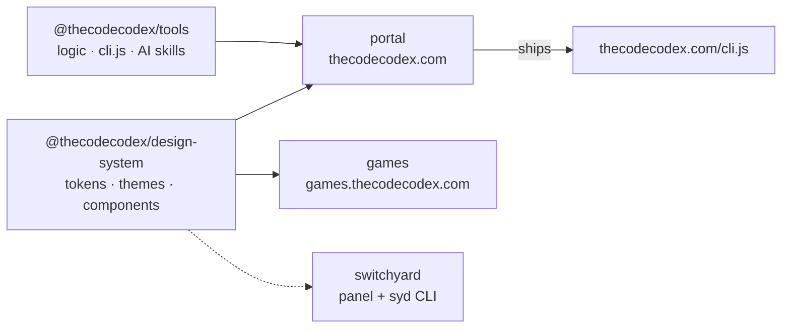

<div align="center">

# The Code Codex

**Study notes, hands-on guides and open-source tools for developers — in Portuguese and English.**

[thecodecodex.com](https://thecodecodex.com) · [Games](https://games.thecodecodex.com) · [Tools](https://thecodecodex.com/pt/tools/) · [`cli.js`](https://thecodecodex.com/cli.js) · [npm](https://www.npmjs.com/org/thecodecodex)

</div>

---

## What we build

| Project | What it is | Stack | |
| --- | --- | --- | --- |
| [**portal**](https://github.com/thecodecodex/portal) | The [thecodecodex.com](https://thecodecodex.com) website: guides, notes, projects and ~20 client-side tools (CLT/PJ salary, invoices, PDF Studio, CPF/CNPJ, JWT, regex, diff…) | Astro · Preact · Tailwind 4 · Pagefind · Cloudflare | 🔒 private |
| [**games**](https://github.com/thecodecodex/games) | [games.thecodecodex.com](https://games.thecodecodex.com): ~40 board, card and party games (chess, backgammon, truco, poker, domino…) with bots and peer-to-peer multiplayer — matches run in the host's browser | Astro · Preact · WebRTC · Cloudflare Workers | 🌐 public |
| [**tools**](https://github.com/thecodecodex/tools) | Pure logic behind every tool, the zero-dependency terminal script `cli.js` and a catalog of AI agent skills | TypeScript · Vitest | [](https://www.npmjs.com/package/@thecodecodex/tools) |
| [**design-system**](https://github.com/thecodecodex/design-system) | Tokens, five themes (light, paper, dusk, dark, high contrast), form components and match components for games (playing cards, player chips, icons) shared by every project | Tailwind 4 · React (Preact-compatible) | [](https://www.npmjs.com/package/@thecodecodex/design-system) |
| [**switchyard**](https://github.com/thecodecodex/switchyard) | Local hub for teams working across many repositories: git dashboard, Azure Boards, GitHub PRs, E2E tests, mocks, databases and cloud logs — a web panel plus the `syd` CLI | Next.js · Go | 🔒 private |



## Principles

- **Everything runs on your machine.** The tools process data in the browser; nothing is uploaded.
- **One logic, many surfaces.** The same functions power the website, the terminal (`cli.js`) and the tests.
- **Open where it matters.** The logic (`tools`) and the visual language (`design-system`) are MIT-licensed and published to npm with provenance.
- **Accessible by default.** Theme colours are chosen for text contrast (including a high-contrast theme), chart colours are validated for colour-vision deficiencies, and keyboard focus is always visible.
- **Bilingual.** Content and tools exist in Portuguese and English, with the same URL parameters in both.

## Try it from the terminal

Every tool on the site also runs outside the browser, with the same parameters as its URL:

```sh
deno run -q "https://thecodecodex.com/cli.js?tool=net-salary&bruto=8000"   # net salary as JSON
curl -s https://thecodecodex.com/cli.js | node --input-type=module - cpf q=3 # three valid test CPFs
deno run -q "https://thecodecodex.com/cli.js"                                # list every tool
```

## Use our packages

```sh
pnpm add @thecodecodex/tools          # finance (BR), CPF/CNPJ, PDF, table conversion, regex, JWT…
pnpm add @thecodecodex/design-system  # Tailwind 4 tokens, themes and React components
```

```ts
import { isValidCpf } from "@thecodecodex/tools/br/cpf"
import { NumberField, Segmented } from "@thecodecodex/design-system"
```

## Working on the projects

Every JavaScript project uses pnpm and the same script names:

| Script | What it does |
| --- | --- |
| `pnpm typecheck` | Type check (`tsc` or `astro check`) |
| `pnpm lint` | Lint without changing files (`lint:fix` applies the fixes) |
| `pnpm test` | Unit tests |
| `pnpm check` | `typecheck` + `lint` + `test` |
| `pnpm verify` | Everything GitHub Actions validates before a deploy or publish (`check` plus builds) |

Run `pnpm verify` before pushing to catch locally what would fail in CI.
